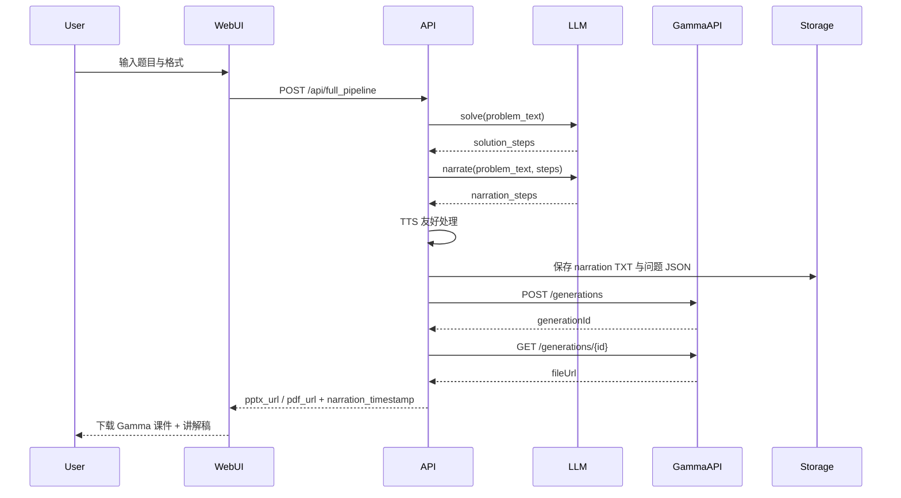

# 南科大高等数学数字人教学项目

AI 驱动的高等数学题目解答与课件生成工具，支持自动解题、生成讲解脚本，并通过 Gamma API 生成高质量 PPTX/PDF 课件。

## 功能特性

- 🤖 **AI 解题**：调用大语言模型自动解答高等数学题目
- 📝 **讲解生成**：将解题过程转换为适合 TTS 的口语化讲解脚本（TXT）
- 🎯 **Gamma 课件**：调用 Gamma Generate API 生成 PPTX 或 PDF
- 🎨 **Web 界面**：简洁易用的本地 Web UI

## 技术栈

- **后端框架**：FastAPI
- **LLM 支持**：通义千问 / Gemini（可扩展）
- **课件生成**：Gamma Generate API（`aiohttp` 异步请求）
- **模板引擎**：Jinja2

## 快速开始

### 1. 安装依赖

**使用 uv（推荐）：**
```bash
uv sync
```

**使用 pip：**
```bash
pip install -e .
```

### 2. 配置环境变量

在项目根目录创建 `.env` 文件并添加：

```env
# LLM 提供商选择（tongyi 或 gemini）
LLM_PROVIDER=gemini

# ========== 通义千问配置 ==========
TONGYI_API_KEY=你的API密钥
TONGYI_MODEL=qwen-max
TONGYI_TIMEOUT=180

# ========== Gemini 配置 ==========
GEMINI_API_KEY=你的Gemini API密钥
GEMINI_MODEL=gemini-2.5-flash
GEMINI_TIMEOUT=120

# ========== Gamma 配置 ==========
GAMMA_API_KEY=你的Gamma API密钥

PORT=8000
```
### 配置gamma_export theme
```
"themeId: "YOUR_THEME_ID"
```
此处可以通过选用不同的模板来调整生成的字体大小以及样式

### 3. 运行服务

```bash 
uv run python main.py
```

服务将在 `http://localhost:8000` 启动。

### 4. 使用 Web 界面

打开浏览器访问 `http://localhost:8000`，输入题目并选择导出格式（PPTX 或 PDF），生成后直接下载 Gamma 生成的课件和讲解稿 TXT。

## API 接口

### 解题接口

```bash
POST /api/solve
Content-Type: application/json

{
  "text": "求极限：$\\lim_{x \\to 0} \\frac{\\sin x}{x}$",
  "topic": "极限",
  "difficulty": "中等"
}
```

### 生成讲解接口

```bash
POST /api/narrate
Content-Type: application/json

{
  "problem_text": "题目文本",
  "solution_steps": [...]
}
```

### 完整流水线接口

```bash
POST /api/full_pipeline?format=pptx
Content-Type: application/json

{
  "text": "题目文本",
  "topic": "极限",
  "difficulty": "中等"
}
```

响应示例：
```json
{
  "gamma_url": null,
  "pptx_url": "https://...",
  "pdf_url": null,
  "narration_timestamp": "20260124_230426"
}
```

### 下载讲解稿

```bash
GET /api/download_narration/{timestamp}
```

## 流程架构（main.py → LLM → Gamma）



## 项目结构

```
.
├── app/
│   ├── __init__.py
│   ├── models/          # 数据模型
│   │   └── schemas.py
│   ├── llm_providers/   # LLM 适配器
│   │   ├── base.py
│   │   ├── tongyi.py
│   │   ├── gemini.py
│   │   └── factory.py
│   ├── prompts/         # Prompt 模板
│   │   ├── solver_prompt.py
│   │   └── narration_prompt.py
│   ├── text/            # 文本处理
│   │   └── tts_friendly.py
│   ├── slides/          # Gamma 课件生成
│   │   └── gamma_export.py
│   ├── routers/         # API 路由
│   │   ├── api.py
│   │   └── web.py
│   └── templates/       # HTML 模板
│       └── index.html
├── problems/            # 题目记录与讲解稿
├── main.py              # 主入口
└── README.md
```

## 许可证

MIT License

